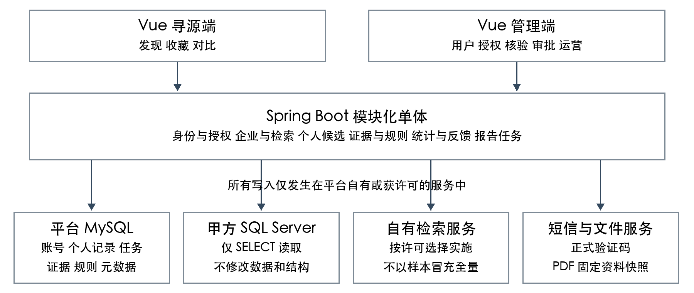

# 供应商寻源平台技术报告

墨西哥国家完整需求实施方案

编制日期：2026-11-09　　版本：1.0　　适用对象：项目组与甲方技术评审

## 1 结论与交付目标

项目目标是在保留甲方原版 HTML 视觉和交互结构的基础上，交付墨西哥国家的完整寻源业务，覆盖 PRD 的 P0、P1、P2 共 26 项功能。寻源端和管理端使用独立入口，前端沿用现有 Vue 3 工程，后端沿用 Spring Boot 与 Java 21；账号及平台自有业务使用 MySQL，甲方 SQL Server 仅作为只读数据源。

当前已具备账号基础流程、真实墨西哥出口记录检索、记录详情及浏览器历史导航。结果仍是一条条贸易记录，尚未形成企业归一、A/B/C 互斥分类、个人候选、对比报告与运营管理的完整闭环。静态原型的页面和演示交互可以复用，但不能计作相应业务功能已经完成。

截止时间按 2027-01-31 前安排，正式验收与交付目标定为 2027-01-29。开发计划以 3 人持续投入为基线，估算 170 人日，其中包含联调验收和缓冲。2 人同期只有约 120 个名义工作人日，存在约 50 人日缺口；若保持完整范围与截止日期，需补齐第三人或采用经确认的等效资源安排。

最先需要解决的是数据与查询能力，而不是继续堆叠页面。2026-11-08 的接入记录显示，墨西哥出口表约 3.10 亿行、进口表约 13.84 亿行，现有检查仅发现记录编号相关聚集主键。单次 HS 查询成功不能证明组合检索、企业统计或并发请求达到 PRD 的 P95 三秒目标。11 月 20 日前必须确定可用的只读检索方案，以及 B/C 通道和企业名录的真实数据依据。

**本期约束。** 不对甲方数据库执行数据修改、DDL、索引或视图创建、存储过程或权限变更；不采购或补造甲方未提供的数据；未经许可，不复制全量源数据到自有检索库。方案设计中的本地表和任务均指平台自有环境。

## 2 需求范围与业务规则

### 2.1 用户与平台边界

采购用户通过寻源端管理自己的搜索、收藏、评价、对比和跟进。管理员通过独立管理入口维护用户、角色、授权、证据、排序规则、审批、统计和反馈。公司名称为可选资料字段，不建立组织、公司共享空间或团队协作模型；管理员也不能以用户管理权限读取私人评价。

墨西哥是本期寻源国家。C 通道可以出现境外企业，但必须有向墨西哥供应当前产品的真实证据，不能将企业所属国家等同于寻源国家。语言基线按 PRD AC-33 保留中文、English、Español、Bahasa Indonesia及“原国家语言”；墨西哥对应西语，印尼语界面不代表接入印尼国家数据。若希望缩减为中英西语，须明确作为范围变更，不能自行豁免。其他国家的真实数据接入不默认纳入本期。

### 2.2 三个供应商通道

| 通道 | 进入条件 | 必须排除的误判 |
| --- | --- | --- |
| A 本地贸易线索 | 企业属于墨西哥，具有当前产品的真实出口记录；或相关进口记录之外另有销售、分销或供货依据 | 不能把只有进口、没有供货依据的企业直接认定为供应商 |
| B 本地名录 | 企业属于墨西哥，存在相关目录产品或经营线索，且不足以进入 A | 不能把空表、演示数据或未经核定的来源标签当真实覆盖 |
| C 境外贸易线索 | 企业位于墨西哥之外，是当前产品真实供方，且贸易目的国为墨西哥 | 发货人不自动等于供方，收货方国家不自动等于目的国；身份不明不强塞分类 |

同一次搜索先匹配产品证据，再做企业归一和通道判定。同企业只出现一次，满足 A 的企业不再重复放入 B。企业类型须有有效依据，不能凭进出口次数推断为制造商、贸易商或分销商。

### 2.3 全站必须统一的规则

- 产品关键词与 HS 至少一项，两项同时填写取交集，并在同一商品证据上成立；国家必选，首次不默认选择，HS 保留前导零。
- 关键词原文与审核词典扩展分开解释。界面语言切换不能改变搜索语义，也不能生成未经核实的规格、认证或经营事实。
- 权限按多角色权限并集加用户额外权限计算；来源许可另行约束。用户、国家、动作、字段及个人记录归属都在服务端校验。
- 收藏、评价、跟进以用户、规范化检索条件和企业为业务键。同一企业在不同条件下的个人记录独立，不因公司同名而共享。
- 七类来源统一为海关、官方目录、登记镜像、黄页或公司目录、B2B 平台、企业或官网、公开网页。对外不暴露具体数据商、源表名、源主键、内部评分或评分解释。
- 缺失显示“暂无信息”；无覆盖显示“暂无可统计记录”；确有覆盖且为零才能显示 0。部分失败、全部失败、无权限和无结果分别表达。
- 贸易记录数不等于订单数或产能；数量、重量、金额、TEU 分开。统计必须保留产品、国家、方向、日期语义、覆盖期、单位、币种和货值口径。
- 综合排序按证据、资料、名录、联系、记录数等维度逐项比较，不做加权评分。贸易量排序仅在可比范围内比较去重记录数。

## 3 当前实现与需求差距

状态含义：“部分”表示已有真实代码但未满足完整验收；“原型”表示只有演示页面或交互；“待建”表示尚无相应正式业务实现。不使用功能项数量估算完成百分比。

### 3.1 P0 基础访问与寻源

| 编号 | 功能 | 当前状态 | 待完成重点 |
| --- | --- | --- | --- |
| P0-01 | 登录退出与会话 | 部分 | 双登录、Session、停用检查已做；补真实短信、审批状态与独立管理入口鉴权 |
| P0-15 | 用户自助注册 | 部分 | 本地 MySQL 持久化及哈希已做；固定码只用于开发，补区号规范化、验证码生命周期和默认角色 |
| P0-02 | 用户授权与角色 | 待建 | 多角色并集、额外授权、国家和字段许可、权限撤回及历史记录 |
| P0-03 | 用户管理 | 原型 | 正式用户列表、启停、最近登录、角色摘要及受控凭证恢复 |
| P0-04 | 数据接入与归一 | 部分 | 只读出口接入已做；补源映射、身份归一、产品关联、覆盖元数据及发布版本 |
| P0-06 | 产品HS国家搜索 | 部分 | 全表条件查询已做；补企业级结果、检索上下文、审核词典、国家授权和性能验收 |
| P0-07 | ABC与双视图 | 部分 | 卡片和表格可用，B/C 仅占位；补真实分类、企业去重、独立计数与勾选对比 |
| P0-08 | 名称与高级筛选 | 部分 | 名称提交筛选、HS 细筛已做；补防抖及获许可的来源、类型、联系、规模和货量条件 |
| P0-09 | 列表与排序 | 部分 | 当前按记录编号翻页；补综合排序、可比贸易量、企业稳定分页和版本绑定 |
| P0-16 | 当地语言检索 | 部分 | 规范化及原文检索存在；补经审核的中英西语词典、版本与命中解释 |
| P0-10 | 企业基础详情 | 部分 | 当前是单条记录详情；补企业主档、真实联系字段及四 Tab 公共结构 |
| P0-17 | 产品与服务 | 原型 | 全量目录、匹配优先、单商品交易条件及目录与贸易商品分区 |
| P0-11 | 贸易画像与覆盖 | 部分 | 单条数量货值已映射；补覆盖、去重指标、趋势、伙伴及同口径明细 |
| P0-12 | 内部排序一致性 | 原型 | 实现证据有效性、维度顺序、稳定业务键和规则版本；禁止公开评分 |

### 3.2 P1 个人候选与对比

| 编号 | 功能 | 当前状态 | 待完成重点 |
| --- | --- | --- | --- |
| P1-01 | 我的收藏 | 原型 | 真实持久化、幂等、首次快照、取消恢复、本人本条件隔离 |
| P1-02 | 我的评价 | 原型 | 1至5星、评论边界、编辑删除、审计；不得影响公共排序 |
| P1-03 | 同条件对比 | 原型 | 2至5家跨通道选择、条件变更确认、三类公共事实与私人判断、只看差异 |
| P1-04 | 反爬与安全事件 | 部分 | 已有基础限流；补成本策略、动态验证、临时限制、恢复和管理事件 |
| P1-05 | 证据核验与重算 | 原型 | 唯一企业关联、产品国家范围、依据和说明、冲突撤销、版本化重算 |
| P1-06 | PDF与历史导出 | 原型 | 一致资料快照、异步任务、文件生成、仅本人历史及下载重新鉴权 |

### 3.3 P2 审批与运营

| 编号 | 功能 | 当前状态 | 待完成重点 |
| --- | --- | --- | --- |
| P2-02 | 个人跟进 | 原型 | 本人本条件状态、收藏前置、变更历史、取消后恢复 |
| P2-03 | 排序规则管理 | 原型 | 五维顺序草稿、发布、恢复、回滚；没有百分比权重或公开分数 |
| P2-04 | 统计分析 | 原型 | 真实采集起点、事件去重、搜索终态、产品词HS国家统计与明细对账 |
| P2-06 | 多语言界面 | 原型 | 正式语言包覆盖前后台、表单错误、图表和PDF；保留当前页面状态 |
| P2-08 | 反馈与后台处理 | 原型 | 校验与幂等入库、联系授权、后台状态流转、处理备注和历史 |
| P2-09 | 注册审批 | 原型 | 待审通过驳回、复审与并发控制；P0 有效存量账号不补审批 |

### 3.4 可复用资产与验证边界

可复用资产包括原版样式与配图、Vue 页面壳、账号模块、MySQL 安装脚本、双数据源、参数化 SELECT、基础限流、错误状态、导航历史及已有测试。现有 MySQL 正式业务结构主要为 sourcing_user；P1/P2 的平台业务数据尚未形成正式持久化结构。

现存后端分组测试报告记录合计 31 项通过，最近前端导航测试为 8 项；这些记录来自不同执行批次，不等于已经通过完整 PRD 回归、生产负载测试或甲方验收。原型中的企业、收藏、评价、排序、图表和导出示例不能进入正式数据和验收统计。

## 4 目标技术架构

建议继续采用前后端分离的模块化单体。2至3人的团队可在一个 Spring Boot 项目内清晰划分模块，复用身份、权限、企业实体和检索上下文；本期不为每个业务功能拆独立微服务。管理端可与寻源端共享组件和构建基础，但入口、路由、鉴权和菜单必须独立。

| 层次 | 职责 | 写入边界 |
| --- | --- | --- |
| Vue 寻源端与管理端 | 复用原版界面，处理路由、状态、表单、语言与可访问性 | 不直连数据库，不决定最终授权 |
| 身份与授权模块 | 注册、短信、登录、角色、额外权限、国家与字段许可 | 平台 MySQL |
| 寻源与企业模块 | 检索上下文、企业归一结果、ABC、详情、画像与排序 | 平台元数据；源库只读 |
| 个人候选模块 | 收藏、评价、跟进、同条件对比 | 平台 MySQL，严格按本人隔离 |
| 运营与任务模块 | 证据、规则版本、审批、事件、反馈、报告任务 | 平台 MySQL及平台文件存储 |
| 数据适配层 | 读取甲方数据，核定映射、覆盖、版本及来源许可 | 不向甲方数据库写入 |
| 可选检索服务 | 在许可和数据方案确定后提供高效召回、企业统计和排序 | 仅自有且获许可的环境 |

数据库迁移脚本只允许指向平台 MySQL。甲方数据源应在结构、配置和运行检查上与初始化、迁移、管理写接口隔离。当前连接的 readOnly 设置属于应用访问设置，不能替代对实际账号权限与允许查询范围的核验。

平台多实例运行时，会话、限流、查询任务和报告任务不能继续依赖单个 JVM 内存；部署拓扑及共享状态方案在第一周确定。开发环境的单实例与固定验证码保留为独立配置，不直接作为生产配置交付。

## 5 墨西哥数据接入设计

### 5.1 候选来源与关联规则

以下为内部技术映射，对外页面和公开 API 不展示源表及源标识。行数取自 2026-11-08 接入记录中的分区元数据，只用于判断规模，不是最新业务精确总数。

| 数据用途 | 候选来源与核定要求 |
| --- | --- |
| A 出口证据 | panjivaMXExport，约 310301340 行；验证供方身份、企业国家、商品与方向 |
| A 进口补充及 C | panjivaMXImport，约 1384083750 行；A 还需独立供货依据，C 需证明境外供方及墨西哥目的国 |
| 企业基础资料 | ciqCompany、ciqCountryGeo、ciqSimpleIndustry；核实实际填充、时效和字段许可 |
| 企业身份关联 | panjivaCompanyCrossRef；确认 identifierTypeId、有效期及一对多冲突，不能直接把贸易供方编号当企业主键 |
| 员工规模 | ciqCompanyData；现有字典记录员工字段类型为35，仍需核定粒度、时点与可用率 |
| 产品与HS | 贸易 goodsShipped、hsCode 及 panjivaHSClassification；目录产品另需真实企业归属与产品数据集 |
| B 本地名录 | 需甲方指定具备经营或目录产品证据的真实来源；只有企业基础表不能自动证明产品经营覆盖 |
| 覆盖与许可 | 需数据源提供方确认可用期间、缺口、刷新时间、国别及字段授权，不能从最早最晚记录自行推断 |

### 5.2 标准化与企业归一

建立平台企业 ID、来源实体映射、企业别名及证据记录。优先使用已核定的来源关联键、国家和登记或税务标识；名称相似只用于产生待核验候选，不能单独自动合并。存在冲突时保留独立主体与复核状态，合并不得静默覆盖个人评价、收藏历史或报告。

贸易记录采用来源命名空间、数据集、源记录 ID 复合键去重。贸易商品通过企业角色与记录关联；目录商品通过可靠企业键关联。产品关键词和 HS 的联合匹配必须对应同一商品证据，不能把企业不同商品的单项命中拼起来。

### 5.3 统计口径

为统计结果保存国家、企业、产品或HS、进出口方向、事件日期类型、覆盖签名、数量单位、币种、货值性质及数据版本。近期统计以最近完整覆盖月为终点，最多回看12个月；部分覆盖分组说明，不补零、不年化、不直接跨源相加。

墨西哥 shpmtDate 的真实事件语义仍需甲方确认，不能仅依据字段名将其标为发货日。目的国映射、商品行与整票货值粒度、TEU、伙伴 ID 也需分别核定。未核定前保留原值与缺失状态，不发布确定性的近期排名和金额趋势。

## 6 全库检索与性能方案

### 6.1 当前查询的能力与限制

现有后端在出口表上按国家、商品原文、HS 和企业名称执行参数化条件查询，并使用记录编号游标分页；每页最多50条，多取1条判断下一页。查询范围没有限制为本地少量样本，但没有提供全库企业去重、精确企业计数或版本化企业排序。

现有 SQL 使用包含匹配、列上的字符处理和 PATINDEX。仅有主键索引时，某些查询可能读取大量记录；即使未来存在其他索引，也必须验证查询表达式、数据分布和实际执行方式，不能承诺“加一个索引就全部变快”。Microsoft 的索引设计指南将可利用索引的条件与实际工作负载作为设计依据。[T1]

接入记录中，HS 8544 每页2条的首屏曾测得约23毫秒；同一环境下 cable 与8544组合触发过12秒超时。前者是单次小页请求，不是 P95 或并发结论。按当前开发约定，搜索 JDBC 执行超时已设为0，浏览器搜索等待计时器也已关闭；普通浏览与详情仍保留原超时，搜索仍有单实例单并发和每用户每分钟12次限制。JDBC 的0表示不限制语句等待时间，不表示查询速度得到改善。[T2]

### 6.2 只读约束下的方案选择

| 方案 | 可用条件 | 本期判断 |
| --- | --- | --- |
| 复用现有只读检索能力 | 甲方已有可用接口、检索服务或高效只读数据集；字段、统计、许可和负载符合需求 | 优先验证；不能把“有视图名称”当作性能已经满足 |
| 自有环境建立检索与汇总 | 取得读取、复制、缓存、保留与更新许可；具备存储、带宽、初始装载及增量方案 | 条件满足后采用；必须按核定全集检索，不用抽样库冒充全量 |
| 继续直接条件扫描 | 不需要持久化复制，但受源表结构、表达式、分布和并发影响 | 保留开发联调能力，不作为三秒性能目标的默认达成方案 |

本计划不包含在甲方源库创建索引、视图、计算列或存储过程。若前两种方案都无法在11月20日前得到数据和许可支持，应把数据性能标记为交付阻塞，并由项目负责人组织资源或交付约束评审，不在代码中悄悄改为只查最近若干条。

### 6.3 目标查询流程

服务端依次完成身份与许可裁剪、检索条件规范化、产品证据召回、企业归一、ABC互斥分类、细筛、版本化排序和稳定分页。检索上下文绑定用户、基础条件、数据版本和规则版本；游标校验上下文，不能跨条件混用。切换卡片表格不重新发起基础搜索，统计与明细使用相同口径。

生产查询保护单独设计为成本预算、排队、取消、资源隔离及明确终态。是否恢复执行上限应在负载测试后按生产策略确认；本报告不改变当前已关闭的开发超时设置。若采用异步查询任务，必须明确任务所有者、幂等、取消、失败和失效规则；不能仅把长期扫描放到后台就宣称性能达标。

## 7 平台数据模型与接口边界

以下为平台自有环境的建议逻辑模型，不是已执行的建表结果。字段、索引和迁移脚本在接口与数据评审后定稿。

| 模型组 | 建议实体 | 关键约束 |
| --- | --- | --- |
| 账号与审批 | user、registration_application、approval_history、login_event | 用户名和规范化手机号唯一；审批状态与启停独立；旧有效账号迁移不补审 |
| 用户授权 | role、permission、user_role、role_permission、user_extra_permission | 多角色并集；额外授权不被角色更新覆盖；保留变更历史 |
| 企业与来源 | company、source_entity_map、company_evidence、source_license | 企业ID与源ID分离；冲突待复核；来源与字段许可可裁剪 |
| 商品与覆盖 | catalog_product、product_evidence、coverage_manifest、data_release | 单商品交易条件；覆盖、单位和版本可追溯；缺失与零分离 |
| 搜索与排序 | search_context、search_snapshot、ranking_rule_version | 用户和基础条件绑定；规则完整发布；最终稳定企业键 |
| 个人候选 | candidate、candidate_review、follow_history、candidate_snapshot | 用户加检索条件加企业唯一；取消收藏不误删历史 |
| 报告任务 | report_job、report_snapshot、report_file | 仅本人任务；生成内容固定；生成与下载分别鉴权；重试幂等 |
| 运营与事件 | feedback、feedback_history、analytics_event、security_event | 业务与统计事件分离；事件去重；不采集凭据或私人正文 |

API 按身份、寻源、企业、个人候选、报告和管理端分组。企业详情公开业务ID，不沿用源主键作为对外标识；当前原始贸易 DTO 及详情地址仍需统一裁剪和迁移。分页、计数、筛选和排序均先裁剪授权，避免通过结果数量推断无权字段。

个人操作的用户 ID 从服务端会话取得，不接受客户端指定他人所有者。查询、修改、导出任务、文件预览和下载都应用相同所有者检查。服务端请求级授权之外，企业、国家、字段及任务级授权还需在业务层执行；Spring Security 请求授权机制可以作为入口控制基础。[T3]

收藏、评价、反馈、审批及导出使用幂等键和数据库唯一约束。证据、排序规则、数据批次和报告分别版本化；报告引用固定的授权资料快照，后续数据和规则发布不回写旧报告。数据库事务不能跨越漫长的远程表扫描或文件生成。

## 8 安全与非功能验收

| 要求 | 交付标准与实现重点 |
| --- | --- |
| 性能 | 在核定数据、并发和网络下，列表首屏与详情主体 P95不超过3秒；组合、稀少、无结果、冷热缓存及并发场景分别测量 |
| 可用性 | 月度目标不低于99.5%；落实监测、备份、故障恢复和回滚。短时联调不能证明月度目标已经达成 |
| 短信与会话 | 生产使用真实服务；验证码绑定手机号和用途、有效期、错误次数、单次消费及独立限流；HTTPS与可信证书 |
| 访问控制 | 寻源和管理独立鉴权；国家、动作、字段、所有者和许可检查贯穿缓存、任务与下载；权限撤回下一次请求生效 |
| 数据隔离 | 私人评价不进入公共排序，管理员不冒用用户读取私评；报告与历史文件不得绕过当前许可 |
| 查询保护 | 分页上限、并发与成本控制、取消和故障分类；开发中关闭的超时不能代替生产保护设计 |
| 隐私与日志 | 不记录密码、验证码、联系值、私人评论和反馈正文到行为事件；产品词按规则脱敏及授权 |
| 一致性 | 唯一性、并发审核、收藏反馈与报告重试幂等；规则与资料版本不混用，撤销和回滚可追查 |
| 浏览器与语言 | Chrome和Edge近两个正式版本、窄屏布局、键盘及无障碍名称；前后台、图表及PDF系统文案完整覆盖 |
| 生命周期 | 上线前核定账号、私有记录、证据、事件、反馈与报告的保留期限、清理、访问和备份策略 |

目前固定码123456和仅中国大陆11位手机号校验是开发替代，与 PRD 的区号规范化、真实短信验证及审批门禁仍有差距。内网联调的信任服务器证书配置也应与生产可信证书配置隔离，不直接照搬上线。

## 9 验收覆盖与发布证据

甲方 PRD 附录B包含36个关键验收场景。项目建立逐条用例、测试数据、执行结果和缺陷记录；下表用于组织执行，不代替原始验收标准。

| 用例组 | 对应编号 | 核查重点 |
| --- | --- | --- |
| 账号审批授权 | AC-01至06 | 双登录、短信异常、审批切换、存量兼容、多角色并集与越权拒绝 |
| 数据与检索 | AC-07至13 | 对外来源裁剪、七类来源、交集、ABC、双视图、名称和高级筛选 |
| 列表详情统计 | AC-14至20 | 爱心、无公开评分、内部处理无独立菜单、四Tab、覆盖口径、排序及稳定分页 |
| 本人候选与对比 | AC-21至24 | 两用户两条件隔离、取消恢复、评价入口、2至5家、条件变更确认 |
| 证据导出防护 | AC-25至27 | 证据版本与重算、报告固定快照、下载鉴权、限流及误拦恢复 |
| 跟进与规则 | AC-28至29 | 跟进历史、收藏前置、规则草稿发布回滚与无权重评分 |
| 统计与多语言 | AC-30至33 | 事件去重、终态分母、用户输入国家、明细对账、审核词典和语言状态保留 |
| 反馈与全站 | AC-34至36 | 联系校验与许可、幂等处理、导航布局、故障空态及性能 |

测试至少覆盖两个用户、多个角色、同企业不同检索条件和权限撤回；构造“有覆盖零结果、无覆盖、部分失败、全部失败、未知角色、冲突企业、多编码HS、单位不同、跨期不同比较”等数据集。企业误合并率按 PRD 目标不高于3%，抽样方法、分层样本量与分母由甲方在测试前核定。

性能验收应在11月20日前确定工作负载。建议从10并发和不少于1000次可观察请求形成候选基线，再由甲方核定；这不是 PRD 已给出的并发承诺。记录端到端 P50、P95、失败、取消、排队、源库负载和冷热缓存，不把失败请求从证据中隐藏，也不使用单次快查询替代验收。

正式发布要求26项需求有可追踪结论，36项关键用例执行完成，阻断级及严重缺陷清零，数据许可和覆盖得到确认，部署回滚及恢复演练通过。真实缺失字段允许按 PRD 降级；缺少 B/C 数据源、未核定统计口径或无法达到性能目标不能默认为完整功能验收通过，必须形成书面处理结论。

## 10 决策事项与交付安排

| 截止日期 | 需要确认的事项 | 责任接口 |
| --- | --- | --- |
| 2026-11-13 | 3人投入、墨西哥范围、历史覆盖、四语基线及部署运维责任 | 项目负责人、甲方产品与技术 |
| 2026-11-13 | 原型与PRD冲突清单、26项需求与36项验收基线、数据来源与许可清单 | 产品接口、前端与数据负责人 |
| 2026-11-20 | 现有只读检索能力或自有检索库许可、容量、更新和性能验证结论 | 数据负责人、甲方数据接口人 |
| 2026-11-20 | 企业关联键、ABC正反例、日期目的国、覆盖、字段许可、目录商品来源 | 数据负责人、甲方业务与数据 |
| 2026-11-20 | 短信服务账号及签名模板可用性、区号范围、正式验证码与安全策略 | 后端负责人、甲方服务负责人 |
| 2026-11-27 | 审核中英西语词典与首批品类、企业归一抽样及统计可比口径 | 数据负责人、甲方业务复核人 |
| 2027-01-08 | 试点账号、验收环境、用例数据、验收人员与判定标准到位 | 项目负责人、甲方验收负责人 |

开发里程碑为：12月11日 P0 可验收，12月25日 P1 可验收，1月15日 P2 功能齐套，1月22日完成联合验收主体工作，1月29日正式交付。各阶段之间可并行开发，但上线前必须逐阶段补齐验收；P2 统计只从真实启用日采集，不补造 P0/P1 历史。

3人计划为紧凑排期，必须按周检查人员、数据方案及缺陷情况。若关键数据、复制许可、真实目录、供方身份、短信或部署条件晚于节点交付，应立刻重排并上报影响；范围、资源或日期变化由项目双方确认，开发组不自行删减完整 PRD 目标。

## 11 依据与参考资料

- [S1] 甲方《供应商寻源平台产品需求文档》，修订记录 V1.0，2026-11-06。需求章节1.3、1.5、2、3及附录A至C。
- [S2] 甲方原型《供应商寻源平台_寻源端.html》《供应商寻源平台_管理端.html》《供应商寻源平台_交互原型.html》。原型中的数据为示例。
- [S3] 当前工程 sourcing-platform 的账号、安全、数据源、墨西哥仓库与搜索代码，MySQL schema.sql，以及 Vue 业务页面和 navigation.js。
- [S4] 工程 docs 中的甲方数据库接入说明、供应商搜索与ABC通道、页面导航与浏览器历史及验收记录；源库规模、索引与耗时为既有接入记录。
- [T1] [Microsoft SQL Server 索引体系与设计指南](https://learn.microsoft.com/en-us/sql/relational-databases/sql-server-index-design-guide?view=sql-server-ver17)。用于检索性能设计原则，不构成对甲方源库修改的授权。
- [T2] [Microsoft JDBC setQueryTimeout 方法说明](https://learn.microsoft.com/en-us/sql/connect/jdbc/reference/setquerytimeout-method-sqlserverstatement?view=sql-server-ver17)。参数0表示不限制等待时间。
- [T3] [Spring Security 请求授权文档](https://docs.spring.io/spring-security/reference/servlet/authorization/authorize-http-requests.html)。用于服务端入口授权设计。

外部技术资料核对日期为2026-11-09。排期与剩余工作量估算见配套《墨西哥寻源平台开发计划》。
