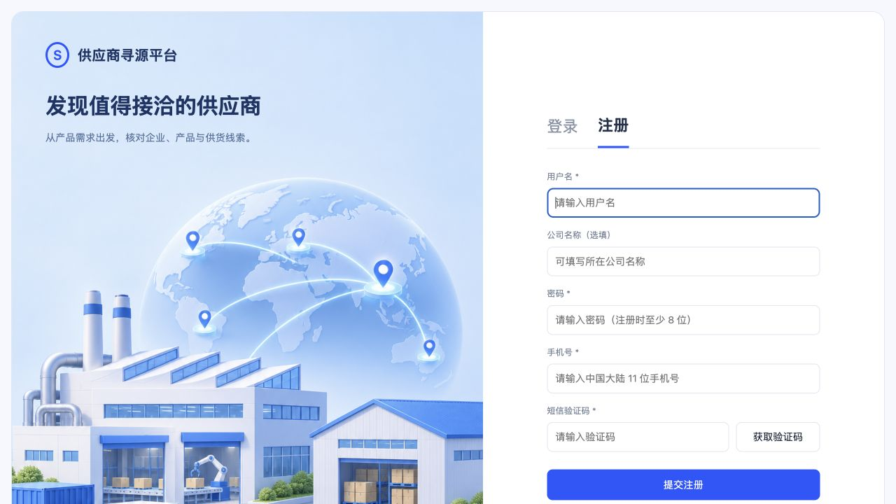

# React 迁移与验证记录

日期：2026-11-11

## 迁移边界

来源为同级 `sourcing-platform`，没有采用 `frontend2` 的另一套界面。Java 业务接口与数据读取逻辑沿用；前端组件迁移至 React 19，开发及构建工具为 Vite 8。保留甲方原型 CSS、登录配图、页面控件和未完成业务入口。未复制原项目的构建缓存、MySQL 数据文件或个人账号数据。

为允许两套项目同时运行，React 版后端端口改为 8082、前端改为 5176，预览端口为 4176。会话 Cookie 改为 SOURCING_REACT_SESSION，避免同一主机不同端口之间覆盖原项目会话。账号数据库、数据库用户和测试数据库独立初始化，复用现有本机 MySQL 服务。

## 状态与页面交互

React 组件通过 Hooks 和 useSyncExternalStore 订阅内存状态；接口请求继续由 api/client.js 统一处理 Cookie、CSRF、错误和超时。页面地址继续使用 History API 与 hash 路由，保留浏览器前进后退、详情直接访问、筛选条件和当前视图恢复。

企业名称字段输入时只更新草稿，回车或失焦后提交筛选，避免每次按键发起全表搜索。高级筛选保留全部原版控件；不支持的条件显示明确提示并阻止误提交。A/B/C 和卡片表格切换保留原有状态。旧请求晚于页面恢复返回时不能覆盖当前结果。勾选最多 5 家，变更顶部搜索条件时确认清空勾选。

未完成的收藏、对比及示例详情保留原型脚本，由 React 容器管理挂载与清理；这部分仍是静态演示，并未增加真实数据写入。

## 验证结果

- 后端 31 项测试通过：注册、重复校验、两种登录、密码安全、会话与 CSRF、接口保护，以及墨西哥查询条件、分页、字段映射等。
- 前端 13 项测试通过：8 项地址与历史状态检查；5 项搜索条件、未接入筛选阻止、通道和视图保持、最多五项勾选及变更确认、旧响应隔离检查。
- Vite 生产构建通过。
- 独立本地测试库的真实 HTTP 检查通过：注册、账号密码登录、手机验证码登录、Cookie 属性、CSRF 轮换、退出与旧会话失效。
- 浏览器手工验证 React 注册与登录、登录后后退至登录页、前进恢复系统；模拟数据验证 HS 搜索、模糊企业筛选、HS 细筛、卡片/表格切换、勾选、高级筛选完整控件和详情页签。

浏览器搜索验证使用单独的临时模拟服务，不查询甲方全表，也不将模拟数据写入交付代码或本地业务账号库。迁移不改变甲方查询方案或性能限制。

## HTTP 检查方式

以下命令仅对新项目的隔离测试库运行。需要已启动本机 MySQL；下方启动命令显式加载 mysql-test.properties 并关闭甲方数据源。首次 seed 会创建固定的测试账号，重复检查用 verify。

```sh
cd "/Users/zhangsusu/Documents/ChatGPT/supply chain/Springboot_React/backend"
mvn spring-boot:run -Dspring-boot.run.profiles=local,test \
  "-Dspring-boot.run.arguments=--server.port=8083 --spring.config.import=optional:file:./data/mysql-test.properties --vendor.enabled=false"
```

另一个终端：

```sh
cd "/Users/zhangsusu/Documents/ChatGPT/supply chain/Springboot_React"
SOURCING_TEST_URL=http://127.0.0.1:8083 node scripts/acceptance.mjs seed
# 再次运行或验证重启后的持久化账号：
SOURCING_TEST_URL=http://127.0.0.1:8083 node scripts/acceptance.mjs verify
```

测试库仅保存测试账号，不与业务账号库或原 Vue 项目数据库混用。不要把检查脚本指向业务环境。

## 分层目录整理

后端现按 controller、service、dao、entity、dto、config、security、exception 分层。UserRepository 与 MexicoExportRepository 分别改名为 UserDao、MexicoExportDao；请求和返回对象独立成文件；数据源诊断也按 Controller → Service → DAO 调用。前端按 pages、layouts、components、models、hooks、api、router、store、utils、styles、assets、legacy 组织。

整理后重新编译，后端原有 31 项测试通过；前端原有 13 项测试与生产构建通过。完整文件职责及旧新位置对照见 [项目目录与分层说明](项目目录与分层说明.md)。样式文件内容、数据库配置、表结构与墨西哥查询 SQL 未改变。

分层后的真实 HTTP 注册、密码登录、手机验证码登录、CSRF 和退出检查再次通过，并确认新建测试账号进入独立测试库。浏览器验证独立 AuthPage 登录成功、后退回登录页及注册表单显示；截图如下。


